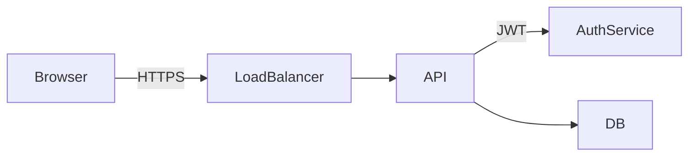

# Pandoc Integration

The Trellis Pandoc Docker image renders Markdown documents with embedded Mermaid diagrams directly to PDF or HTML. No pre-processing step, no local Trellis install, no separate diagram export. Write Mermaid in your Markdown, get clean diagrams in your output.

Designed for teams that write documentation in Markdown and need diagrams that ship with the document.

---

## Prerequisites

Docker. That's it.

---

## Usage

### Pull the image

```bash
docker pull trellislab/trellis-pandoc:latest
```

The image is on Docker Hub for `linux/amd64` and `linux/arm64`.

### Render to PDF

```bash
docker run --rm -v "$(pwd):/data" trellislab/trellis-pandoc:latest document.md -o document.pdf
```

### Render to HTML

```bash
docker run --rm -v "$(pwd):/data" -v trellis-license:/root/.config/trellis -e TRELLIS_KEY \
  trellislab/trellis-pandoc:latest document.md -o document.html
```

The `-v "$(pwd):/data"` flag mounts your current directory into the container. Both the input file and the output file are resolved relative to that directory.

All other Pandoc arguments (`--toc`, `--pdf-engine=xelatex`, templates in `/data`, …) are passed through.

### License key

PDF, DOCX and the other non-HTML formats use PNG diagrams, which are free. HTML output inlines SVG, which needs a license key: pass it with `-e TRELLIS_KEY` (taken from your shell environment). Without a key, HTML output embeds PNG images instead, and `architecture-beta` diagrams are drawn by the Mermaid fallback renderer.

A key is activated on first use, which uses one seat. The `trellis-license` volume keeps that activation; without it, every container run activates the key again and uses another seat.

---

## Example Markdown

````markdown
# System Design

Here is the authentication flow:



The diagram above is rendered automatically.
````

Save this as `document.md` and run:

```bash
docker run --rm -v "$(pwd):/data" trellislab/trellis-pandoc:latest document.md -o document.pdf
```

The `mermaid` code blocks become embedded images in the output. No external image references.

---

## Advanced: Lua filter directly

If you have Pandoc and the `trellis` binary installed locally, you can run the filter without Docker:

```bash
pandoc --lua-filter=filters/trellis-filter.lua document.md -o document.pdf
```

Requirements:
- Pandoc installed locally
- `trellis` binary in your `PATH`
- `filters/trellis-filter.lua` from this repository

The Docker image is recommended for reproducible builds and CI environments.

---

## Output note

Flowchart, class, ER, C4 and `architecture-beta` blocks are rendered by Trellis; frontmatter and `%%{init}%%` lines before the diagram keyword are fine. Other Mermaid types (sequence, gantt, …) are rendered by the bundled Mermaid CLI. A block that fails to parse is left as a code block, with a `[trellis-filter]` message on stderr.

The diagrams are self-contained — no external images, no CDN references. PDF, DOCX and other formats embed PNG images. HTML output inlines SVG (licensed), or embeds PNG images without a license key.
